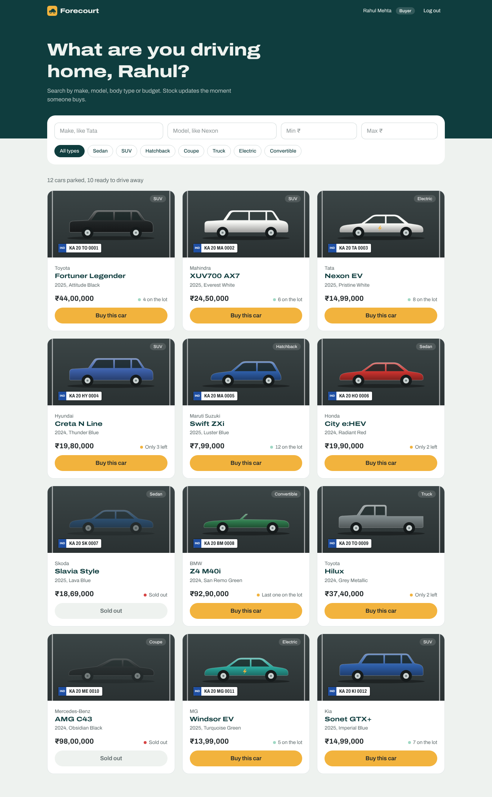
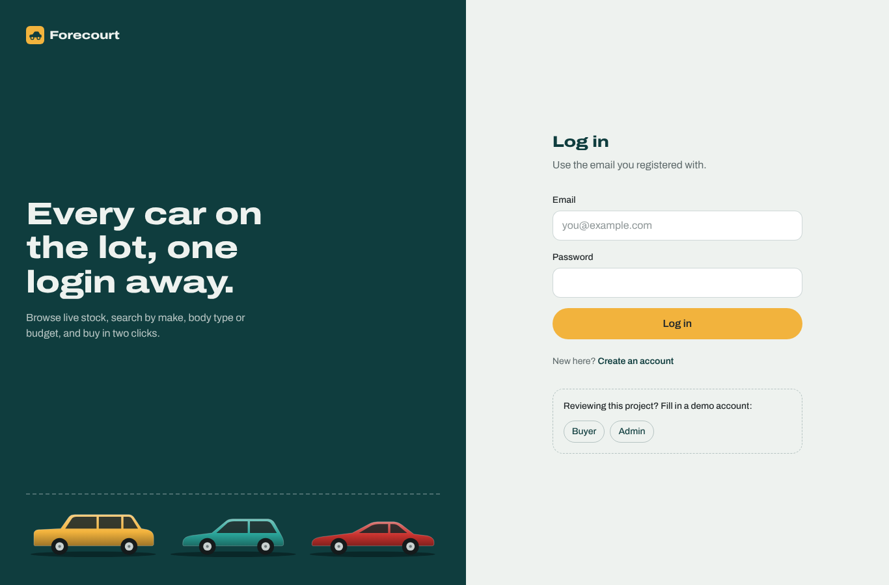
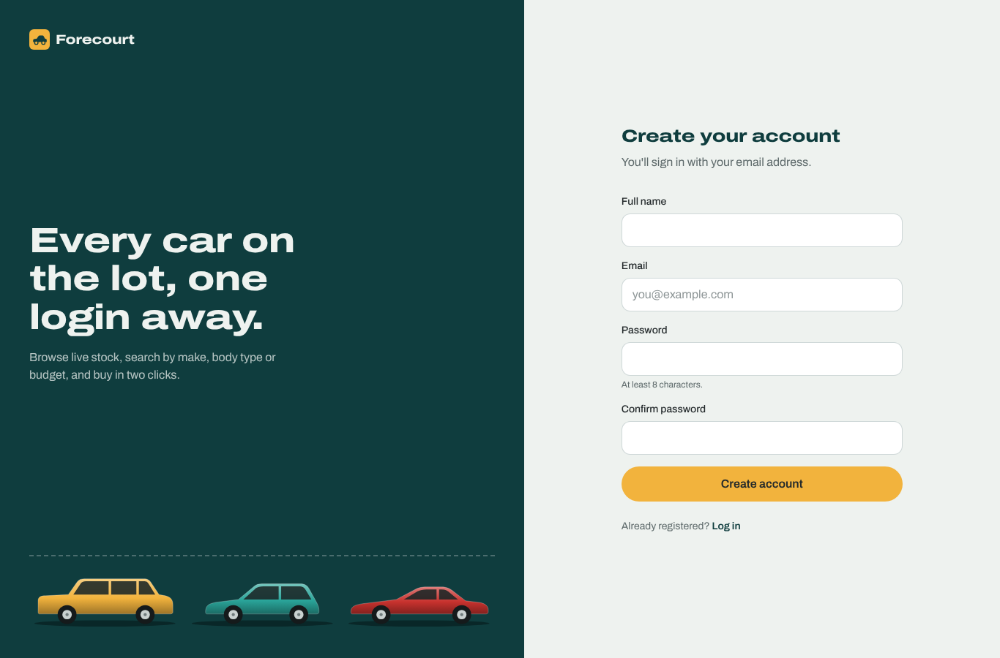
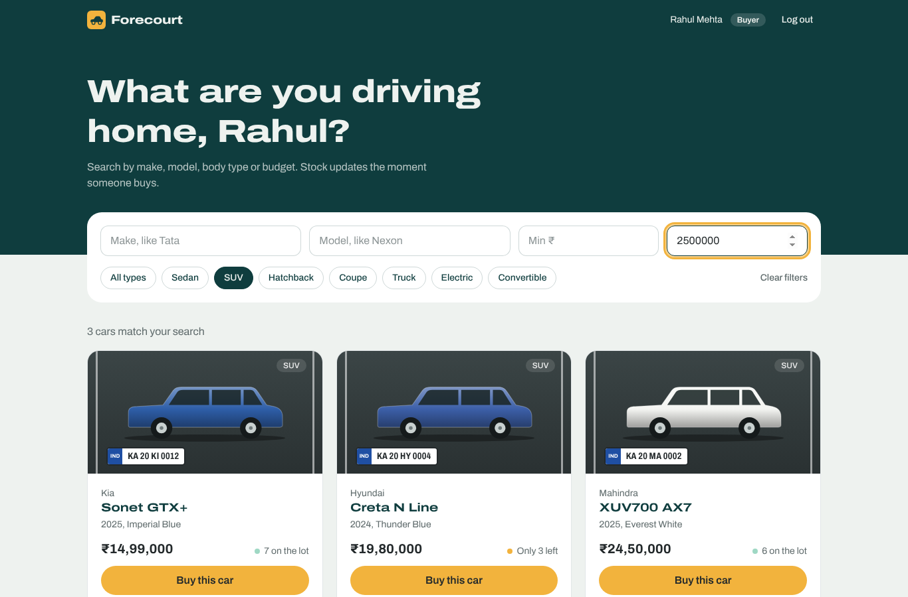
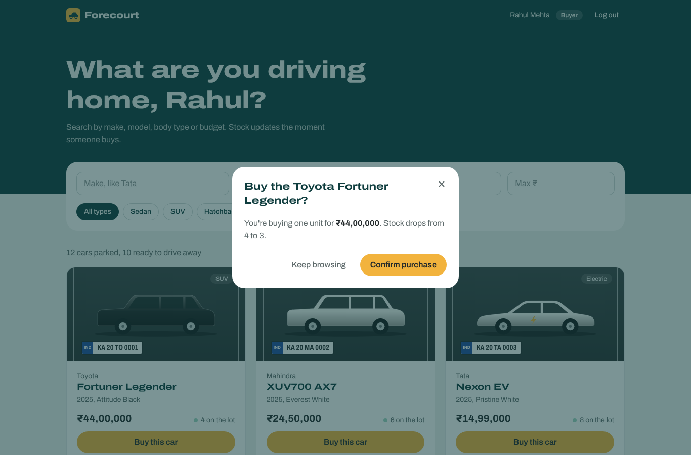
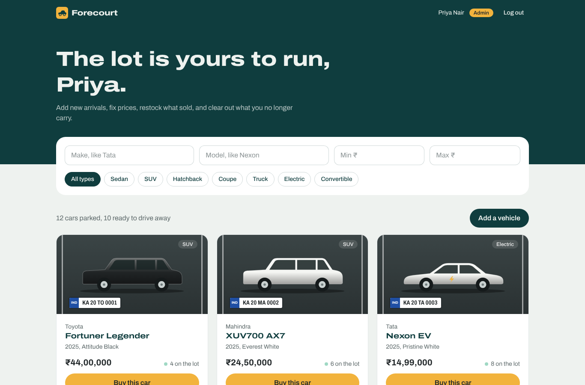
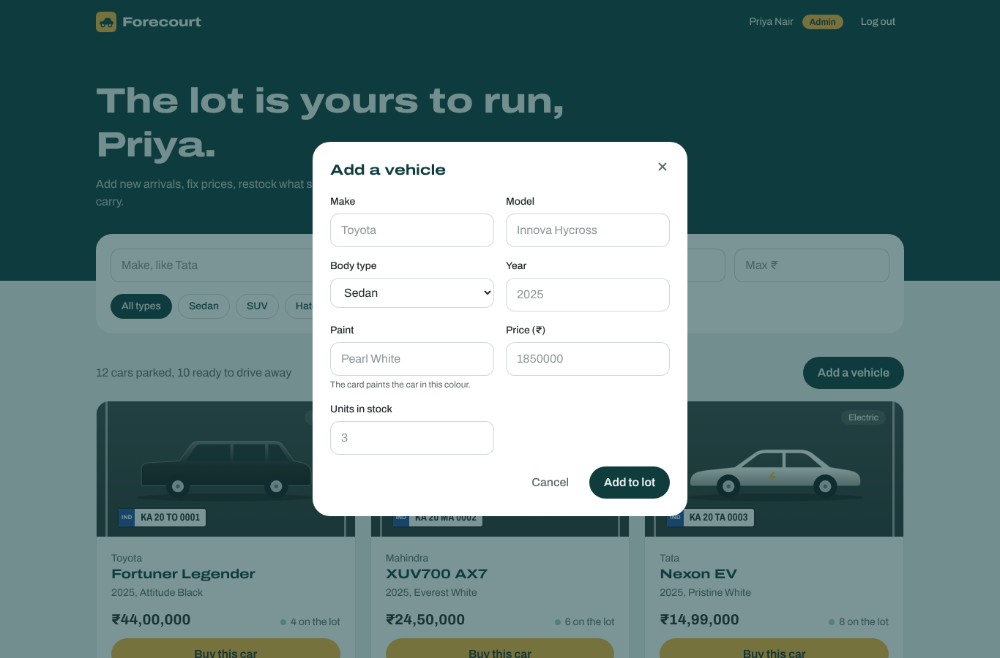
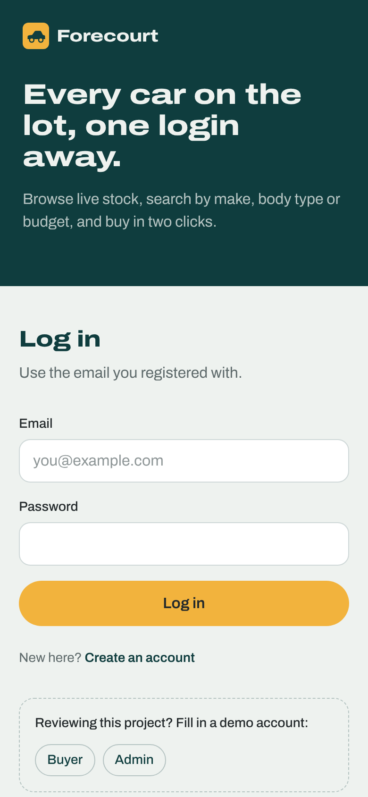
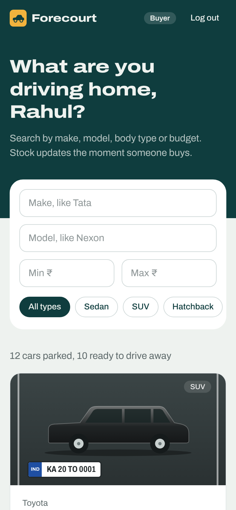

# Forecourt: Car Dealership Inventory System

A full-stack inventory app for a car dealership. Buyers register with their email, browse the lot, search by make, model, body type or price, and buy a car, which drops its stock instantly. Admins add new arrivals, edit details, restock and delete vehicles.

- **Backend:** Python, FastAPI, SQLAlchemy, PostgreSQL (SQLite for local dev), JWT auth
- **Frontend:** React 19, Vite, Tailwind CSS v4, React Router
- **Tests:** pytest (69 tests, 97% coverage) and Vitest + Testing Library (28 tests). See [TEST_REPORT.md](TEST_REPORT.md)

> **Live demo:** _add your Vercel link here_ · **API docs:** _add your Render link_/docs
> Demo accounts (one click on the login page): buyer `buyer@example.com` / `buyer12345`, admin `admin@dealership.com` / `admin12345`



---

## Contents

1. [Features](#features)
2. [How it works](#how-it-works)
3. [Run it locally](#run-it-locally)
4. [Running the tests](#running-the-tests)
5. [API reference](#api-reference)
6. [Deployment](#deployment)
7. [Screenshots](#screenshots)
8. [Design decisions](#design-decisions)
9. [My AI Usage](#my-ai-usage)

---

## Features

**Everyone (after logging in)**
- Register and log in with email + password; the session is a JWT stored in the browser
- Browse every vehicle on the lot with price, colour, year and live stock
- Search by make and model (partial, case-insensitive), filter by body type and a price range; filters combine
- Buy a car with a confirmation step; the **Buy** button is disabled when stock is 0

**Admins**
- Add a vehicle, edit any field, restock, and delete (with confirmation)
- Admin rights come from server configuration (`ADMIN_EMAILS`), never from anything the client sends

**Details that matter**
- Purchases are **atomic**: two people can't buy the last car at the same time (see [design decisions](#design-decisions))
- Stock and price can never go negative: validated in the API **and** enforced by database `CHECK` constraints
- Prices use `Numeric`/`Decimal`, not floats, and display in Indian format (₹44,00,000)
- Each car is drawn as a side-profile silhouette for its body type, painted in its actual colour, with a number-plate stock badge
- Responsive down to phone width, keyboard accessible, respects reduced-motion settings

## How it works

```
┌────────────────────┐   HTTPS + JSON    ┌──────────────────────────────┐   SQL    ┌──────────────┐
│  React SPA         │ ────────────────▶ │  FastAPI                      │ ───────▶ │  PostgreSQL  │
│  (Vercel)          │  Authorization:   │  routers → services → models  │          │  (Neon)      │
│  AuthContext keeps │  Bearer <JWT>     │  (Render)                     │ ◀─────── │  SQLite in   │
│  the token         │ ◀──────────────── │                               │          │  local dev   │
└────────────────────┘                   └──────────────────────────────┘          └──────────────┘
```

### Backend layers

| Layer | File(s) | Job |
|---|---|---|
| Routers | `app/routers/auth.py`, `vehicles.py` | HTTP only: parse the request, call a service, map errors to status codes |
| Services | `app/services/auth_service.py`, `vehicle_service.py` | Business rules (duplicate email, stock checks, search filters). No HTTP code. |
| Dependencies | `app/dependencies.py` | `get_current_user` and `require_admin`, plugged into routes with `Depends(...)` |
| Schemas | `app/schemas.py` | Pydantic models for what goes in and out of the API (validation lives here) |
| Models | `app/models.py` | SQLAlchemy tables: `users`, `vehicles` |
| Database | `app/database.py` | Engine, sessions, `get_db` per-request session |
| Security | `app/security.py` | bcrypt hashing, JWT create/verify |
| Config | `app/config.py` | Every setting from environment variables |

### Database

Two tables, created on startup by SQLAlchemy (`Base.metadata.create_all`):

```
users                                   vehicles
───────────────────────────────         ──────────────────────────────────────────
id              integer  PK             id          integer   PK
email           varchar  UNIQUE, index  make        varchar   index
full_name       varchar                 model       varchar   index
hashed_password varchar  (bcrypt)       category    varchar   index  (Sedan, SUV, …)
is_admin        boolean                 year        integer   nullable
created_at      timestamptz             price       numeric(12,2)  CHECK price >= 0
                                        quantity    integer        CHECK quantity >= 0
                                        color       varchar   nullable
                                        created_at, updated_at  timestamptz
```

The same code talks to SQLite locally and PostgreSQL in production. Only the `DATABASE_URL` environment variable changes.

### Auth flow

1. `POST /api/auth/register` validates the email (`EmailStr`) and password (8+ chars), hashes the password with bcrypt and stores the user. It returns a JWT straight away.
2. `POST /api/auth/login` checks the bcrypt hash and returns a JWT signed with `JWT_SECRET`, valid for 24 hours. A wrong password and an unknown email give the **same** error, so the form can't be used to discover who has an account.
3. The React app stores the token and sends `Authorization: Bearer <token>` on every call.
4. Protected routes run `get_current_user`, which verifies the signature and expiry, then loads the user. Admin routes add `require_admin` (403 for non-admins).
5. If a token expires, the API returns 401 and the frontend logs the user out automatically.

## Run it locally

**You need:** Python 3.11+ and Node.js 20+.

### 1. Backend (terminal 1)

```bash
cd backend
python -m venv .venv
# Windows:  .venv\Scripts\activate
# Mac/Linux: source .venv/bin/activate
pip install -r requirements.txt
cp .env.example .env          # Windows: copy .env.example .env
python seed.py                # creates the demo users and 12 cars
uvicorn app.main:app --reload
```

The API runs on http://localhost:8000. Interactive docs are at http://localhost:8000/docs.

### 2. Frontend (terminal 2)

```bash
cd frontend
npm install
cp .env.example .env          # Windows: copy .env.example .env
npm run dev
```

Open http://localhost:5173 and click **Buyer** or **Admin** under the login form.

## Running the tests

```bash
cd backend && pytest -vv --cov=app --cov-report=term-missing
cd frontend && npm test
```

Backend tests run against a fresh in-memory SQLite database per test, so they never touch your real data and can run in any order. Frontend tests mock `fetch`, so they don't need the backend running. Full results: [TEST_REPORT.md](TEST_REPORT.md).

## API reference

All `/api/vehicles` routes require `Authorization: Bearer <token>`.

| Method | Path | Who | What it does |
|---|---|---|---|
| POST | `/api/auth/register` | anyone | Create an account `{email, full_name, password}`, returns a token |
| POST | `/api/auth/login` | anyone | `{email, password}`, returns a token |
| GET | `/api/auth/me` | logged in | The current user |
| GET | `/api/vehicles` | logged in | All vehicles |
| GET | `/api/vehicles/search` | logged in | Filters: `make`, `model`, `category`, `min_price`, `max_price` |
| GET | `/api/vehicles/categories` | logged in | The allowed body types |
| POST | `/api/vehicles` | admin | Add a vehicle |
| PUT | `/api/vehicles/{id}` | admin | Update any fields (partial update) |
| DELETE | `/api/vehicles/{id}` | admin | Delete a vehicle (204) |
| POST | `/api/vehicles/{id}/purchase` | logged in | Buy; optional body `{quantity}` (default 1). 400 if not enough stock |
| POST | `/api/vehicles/{id}/restock` | admin | `{quantity}` to add |

Errors: `401` not logged in or bad token · `403` not an admin · `404` no such vehicle · `409` email already registered · `422` invalid input · `400` not enough stock.

## Deployment

| Piece | Where | Cost |
|---|---|---|
| PostgreSQL | [Neon](https://neon.com) | Free plan, doesn't expire |
| FastAPI | [Render](https://render.com) web service | Free (sleeps after 15 min idle; first request then takes about a minute) |
| React | [Vercel](https://vercel.com) | Free |

1. **Database (Neon):** create a project and copy the connection string (`postgresql://…?sslmode=require`).
2. **Seed it from your laptop:** `cd backend` then `DATABASE_URL="<neon url>" python seed.py`. On Windows PowerShell: `$env:DATABASE_URL="<neon url>"; python seed.py`.
3. **API (Render):** New → Blueprint → select this repo (it reads `render.yaml`). Paste the Neon URL for `DATABASE_URL`. Set `CORS_ORIGINS` to your Vercel URL once you have it. Check `https://<your-api>.onrender.com/api/health`.
4. **Frontend (Vercel):** New Project → import the repo → Root Directory `frontend` → add env var `VITE_API_URL=https://<your-api>.onrender.com` → Deploy. `vercel.json` makes page refreshes on `/login` work.
5. Go back to Render and make sure `CORS_ORIGINS` exactly matches the Vercel URL (no trailing slash).

## Screenshots

| Login | Register |
|---|---|
|  |  |

| Search: SUVs under ₹25 lakh | Buying a car |
|---|---|
|  |  |

| Admin view | Adding a vehicle |
|---|---|
|  |  |

| Phone: login | Phone: showroom |
|---|---|
|  |  |

## Design decisions

- **Atomic purchase.** The naive version (read quantity, subtract 1, save) lets two buyers both see "1 left" and both succeed. Instead the service runs one conditional statement, `UPDATE vehicles SET quantity = quantity - n WHERE id = :id AND quantity >= n`, and checks whether a row was changed. The database does the check and the write in one step, so overselling is impossible. The `CHECK (quantity >= 0)` constraint is a second safety net.
- **Create and update are admin-only.** The brief marks only delete and restock as admin-only, but it also lists add/update forms under "For Admin Users". A customer shouldn't be able to change a car's price, so I protected all four write operations with `require_admin`.
- **Admins come from config.** `ADMIN_EMAILS` decides who is an admin at registration. There is no `is_admin` field the client can send, which closes a common privilege-escalation hole.
- **Services separate from routers.** Routers only translate HTTP; services hold the rules and raise plain Python exceptions. Each layer has one reason to change, and the rules can be tested without HTTP.
- **Tables via `create_all`.** Fine for two tables. For a growing schema I'd add Alembic migrations.
- **Token in localStorage.** Simple and fits a take-home. In production I'd consider an httpOnly cookie to reduce XSS exposure.

## My AI Usage

> ✏️ **Shaurya: rewrite this section in your own words before submitting.** It must be true. Keep what happened, delete what didn't, and add your own changes and reflections. Interviewers will ask about it.

**Tools used**
- **Claude (Anthropic), Opus model, in the claude.ai app.** The full, unedited conversation is linked in [PROMPTS.md](PROMPTS.md).

**How I used it**
- I gave Claude the assignment PDF and asked for a FastAPI + React implementation with email login and a distinctive design.
- Claude generated the first complete version of the backend, the tests, the React frontend, this README and the test report, and ran both test suites in its own sandbox.
- I rebuilt the repository commit by commit in red-green order: I added each test file first, ran it and watched it fail, then added the code that made it pass. Every such commit has a `Co-authored-by` trailer for Claude.
- I read through every file so I can explain it. _(List anything you changed yourself, e.g. renamed something, adjusted a colour, added a test, fixed a deployment issue.)_
- I deployed it myself to Neon, Render and Vercel. _(Note any problems you hit and how you fixed them.)_

**Reflection** _(write 3–5 honest sentences of your own; prompts below)_
- What did AI speed up most, and what did you still have to understand or decide yourself?
- Where would you not trust AI output without checking? (e.g. security: admin rights, the purchase race condition)
- What would you do differently next time?
